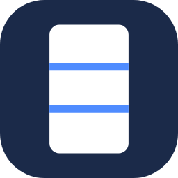
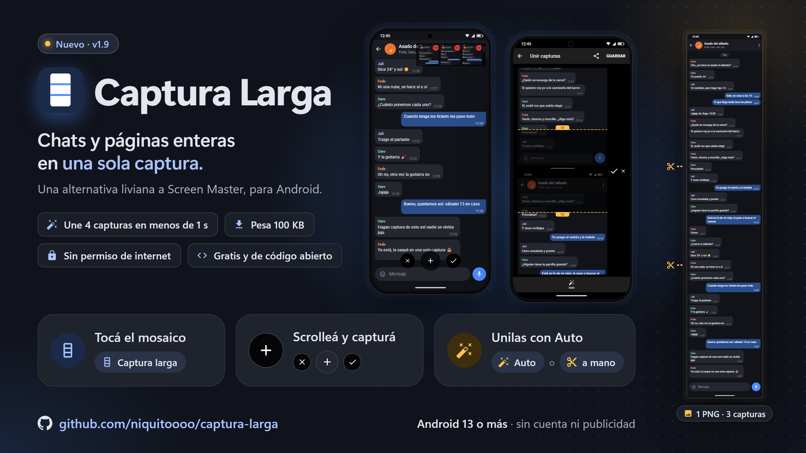

<div align="center">



# Captura Larga

**Capturas de pantalla largas para Android: chats y páginas enteras en una sola imagen.**<br>
Una alternativa liviana a Screen Master, sin publicidad y sin permiso de Internet.

[](https://github.com/niquitoooo/captura-larga/releases/latest)
[](https://github.com/niquitoooo/captura-larga/actions/workflows/compilacion.yml)
[](LICENSE)


[**Descargar**](https://github.com/niquitoooo/captura-larga/releases/latest) ·
[Cómo se usa](#cómo-se-usa) ·
[Cambios](CHANGELOG.md)

</div>

> **English:** Captura Larga is a tiny (100 KB) long-screenshot app for Android 13 and later, inspired by Screen
> Master. Start it from a Quick Settings tile, scroll and tap `+` to capture, then join the captures in the editor,
> automatically (Auto) or by hand with the scissors. No ads, no account and no Internet permission. The interface is
> in Spanish.

<p align="center">
  
</p>

## Cómo se usa

1. **Tocá el mosaico «Captura larga»** en Ajustes rápidos. El panel se cierra y abajo aparecen tres botones:
   cerrar (✕), capturar (+) y listo (✓).
2. **Scrolleá y tocá +** en cada tramo, dejando que una captura se solape un poco con la siguiente. Arriba a la
   derecha se van juntando las miniaturas, cada una con un botón para quitarla. Entran hasta 20 capturas.
3. **Tocá ✓** para abrir **Unir capturas**: las capturas aparecen una debajo de la otra y cada unión tiene una
   tijera para recortar a mano lo que se repite, con deshacer. **Auto** busca todas las uniones solo.
4. **Guardar** deja un PNG en `Pictures/Screenshots`; **Compartir** lo manda a otra app.

## Qué tiene adentro

- **Auto en menos de un segundo.** Sigue la regla del unido automático de Screen Master: toma una franja del 5 % del
  alto al final de cada captura y la busca en la siguiente con correlación normalizada (la `TM_CCOEFF_NORMED` de
  OpenCV, escrita acá desde cero). Con 98 % de parecido o más corta ahí; si no, prueba la franja de arriba. En un
  Pixel une 4 capturas en menos de un segundo.
- **El mosaico responde al toque.** Android mantiene conectados solo tres mosaicos de apps a la vez y los demás
  tardan unos segundos en reaccionar. El de Captura Larga es un mosaico activo que abre una actividad invisible, así
  que los botones aparecen enseguida aunque no sea uno de esos tres.
- **El PNG se escribe de a una fila**, así que unir 20 capturas no necesita tener toda la imagen en memoria.
- **Sin dependencias**: solo Kotlin y el SDK de Android. El APK pesa unos 100 KB.

## Instalación

1. Bajá `CapturaLarga-x.y.z.apk` desde [**Releases**](https://github.com/niquitoooo/captura-larga/releases/latest)
   y abrilo. Android te va a pedir permiso para instalar apps desde el navegador o el administrador de archivos.
2. Abrí Captura Larga y tocá **Abrir ajustes de accesibilidad**. Activá el servicio **Captura Larga**: es lo que le
   permite sacar las capturas y mostrar los botones flotantes.
3. Si Android dice que es un **ajuste restringido**, andá a Ajustes → Apps → Captura Larga, tocá los tres puntos de
   arriba a la derecha y elegí **Permitir ajustes restringidos**. Después volvé a activarlo.
4. Tocá **Agregar el mosaico a Ajustes rápidos**.

Requiere Android 13 o más.

> [!NOTE]
> Como usa un servicio de accesibilidad y muestra botones sobre otras apps, Play Protect puede avisar que es una app
> desconocida o que tiene un comportamiento inusual. El código completo está en este repositorio.

## Privacidad

- **No pide ningún permiso**: ni Internet, ni almacenamiento, ni notificaciones. No tiene publicidad, cuenta ni
  telemetría.
- El servicio de accesibilidad solo saca capturas y dibuja los botones flotantes. **No lee el contenido de la
  pantalla ni lo que escribís**: no pide acceso al contenido de las ventanas.
- Las capturas sueltas quedan en la caché privada de la app y se borran al guardar o al cerrar con ✕. El resultado
  se guarda en `Pictures/Screenshots`.

## Compilar desde el código

Requisitos: JDK 17 o más (se usa el 21) y el SDK de Android con la API 36.

```bash
git clone https://github.com/niquitoooo/captura-larga.git
cd captura-larga
./gradlew testDebugUnitTest assembleDebug
```

El APK queda en `app/build/outputs/apk/debug/app-debug.apk`. Para un APK de release firmado con tu propia clave,
creá un `keystore.properties` en la raíz con `storeFile`, `storePassword`, `keyAlias` y `keyPassword`, y corré
`./gradlew assembleRelease`. Los APK publicados en Releases están firmados con una clave que no está en el
repositorio.

### Estructura

| Carpeta (`app/src/main/java/com/prieto/capturalarga`) | Contenido |
|---|---|
| raíz | Servicio de accesibilidad, mosaico, botones flotantes (`StitchControls`) y editor (`PreviewActivity`, `CaptureCropView`) |
| `stitch` | `StripMatcher` (Auto), `StitchEdit` (recortes de cada unión) y `StitchRenderer` (arma la imagen final) |
| `session` | Las capturas de la sesión en curso |
| `frame` | Formato de las capturas sin comprimir y lectura por filas |
| `png` | `PngWriter`, que escribe el PNG fila por fila |

Los tests (JUnit) están en `app/src/test`.

## Créditos

El aspecto, el funcionamiento y la regla de Auto siguen al modo de captura larga de Screen Master; el código es
propio. Los íconos de los botones son de [Material Icons](https://github.com/google/material-design-icons) de Google
(Apache 2.0).

## Licencia

[GPL v3](LICENSE).
